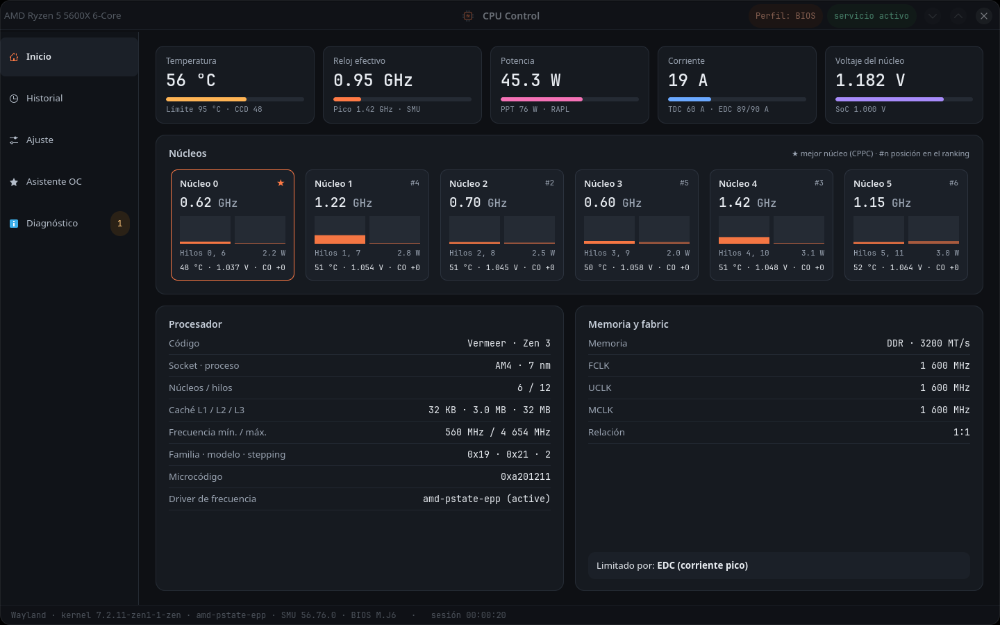
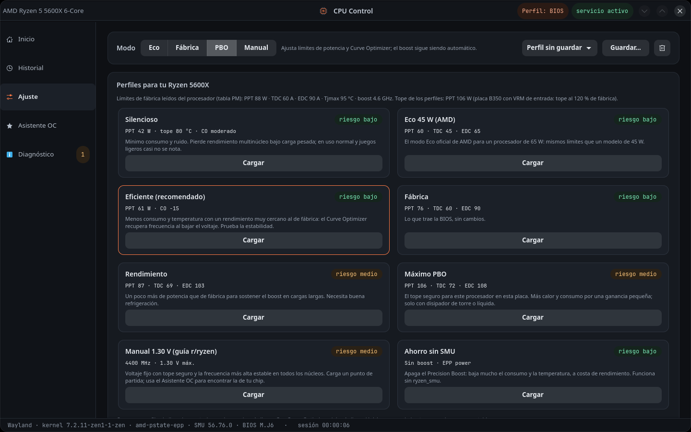
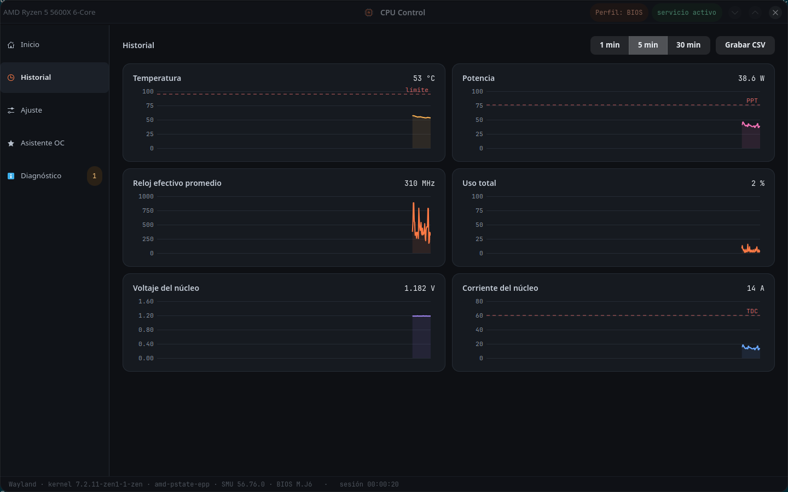
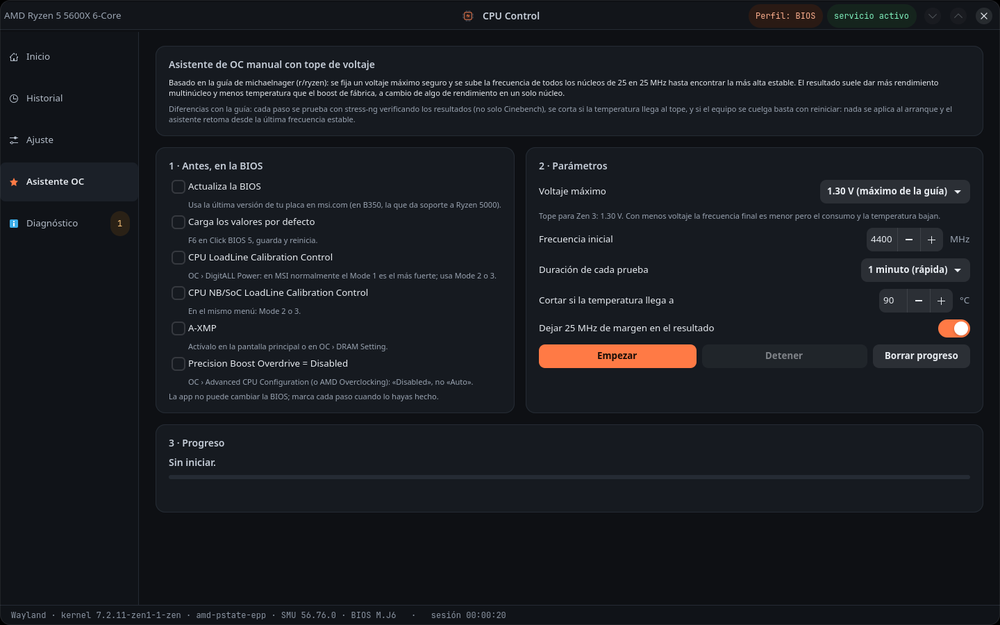
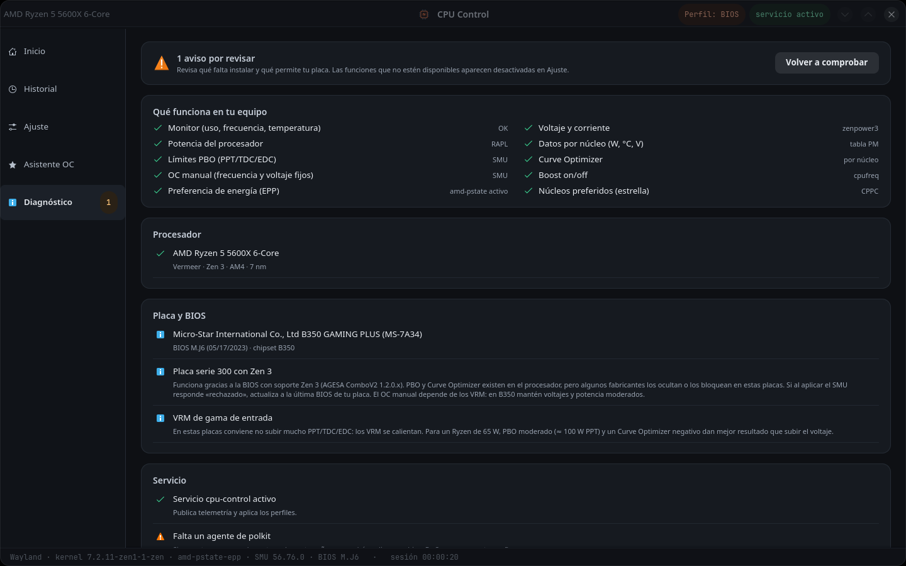

# CPU Control

Monitor y ajuste de procesadores **AMD Ryzen** para Linux, al estilo de Ryzen Master.
Nativo **Wayland** (GTK4 + libadwaita). Funciona desde Zen 1 hasta Zen 5 y detecta qué
permite tu procesador, tu placa y tu BIOS.



| | |
|---|---|
|  |  |
| **Ajuste**: modos y perfiles calculados para tu procesador | **Historial** de 1, 5 y 30 min |
|  |  |
| **Asistente OC** con tope de voltaje | **Diagnóstico** de lo que permite tu equipo |

## Qué hace

- **Inicio**: temperatura, reloj efectivo, potencia, corriente (TDC/EDC) y voltaje. Muestra
  una tarjeta por núcleo, agrupada por CCD/CCX, con frecuencia, uso de cada hilo, vatios,
  °C, voltaje y Curve Optimizer. La ★ marca el mejor núcleo (CPPC). También muestra
  memoria/FCLK y qué límite está frenando al procesador.
- **Historial**: gráficas de 1, 5 y 30 minutos, y grabación a CSV.
- **Ajuste**: modos Eco / Fábrica / PBO / Manual.
  - Límites PPT, TDC, EDC, temperatura y escalar PBO.
  - Curve Optimizer para todos los núcleos o por núcleo.
  - OC manual (frecuencia y voltaje fijos).
  - Boost, EPP, gobernador y frecuencias mínima y máxima.
  - Perfiles guardados y opción de aplicarlos al iniciar.
- **Diagnóstico**: lista lo que falta instalar (con el comando exacto), lo que tu placa o
  BIOS no permite y qué funciones quedan activas en tu equipo.

## Perfiles recomendados

La pestaña Ajuste muestra solo los perfiles que tu modelo soporta. Salen de una tabla con
más de 50 Ryzen de escritorio (TDP, Tjmax, boost y límites de socket de AMD) y se
recortan a un **tope seguro**:

| Caso | Tope de PPT/TDC/EDC |
|---|---|
| X3D | igual que fábrica (no se suben) |
| Placa A320 / A520 / B350 / A620 | 120 % de fábrica |
| Placa B450 | 130 % de fábrica |
| Resto | 140 % de fábrica |

Los perfiles son Silencioso, Eco (el oficial de AMD), Eficiente, Fábrica, Rendimiento,
Máximo PBO (solo si cabe en el tope) y Ahorro sin SMU.

Curve Optimizer de los perfiles:
- Zen 3: −10 a −15. Zen 4/5: −20 a −25.
- Los dos mejores núcleos (CPPC) van 5 puntos menos agresivos.
- Cada chip es distinto: prueba la estabilidad antes de activar «Aplicar al iniciar».

Para el Ryzen 5 5500 en una B350:

| Perfil | PPT / TDC / EDC | CO |
|---|---|---|
| Silencioso | 48 W, tope 80 °C | −10 |
| Eco 45 W | 60 / 45 / 65 | — |
| Eficiente | 70 W | −15 |
| Fábrica | 88 / 60 / 90 | — |
| Rendimiento | 101 / 69 / 103 | −10 |

«Máximo PBO» no aparece en ese equipo porque pasaría del tope de la placa.

## Asistente OC (guía de michaelnager, r/ryzen)

Implementa la guía «Definitive Guide to Configuring Ryzen CPUs»:
1. En la BIOS: valores por defecto, LLC del Vcore y del SoC en el 2.º o 3.º nivel, XMP y PBO
   desactivado. La app muestra la lista con los nombres de menú de MSI cuando detecta una placa MSI.
2. Voltaje fijo con tope: **1.30 V en Zen 2/3** y **1.20 V en Zen 4/5**. También se pueden elegir
   0.05 o 0.10 V menos, para priorizar la eficiencia.
3. Sube la frecuencia de todos los núcleos de 25 en 25 MHz y prueba cada paso con
   `stress-ng --verify`. Corta si la temperatura llega al tope.
4. Antes de cada paso guarda el estado en disco. Si el equipo se cuelga, al reiniciar marca esa
   frecuencia como fallida y propone la última estable, con 25 MHz de margen.

Nada se aplica al arranque durante las pruebas. Requiere `sudo pacman -S stress-ng`.

Ten en cuenta que el OC manual desactiva el boost automático y los límites PPT/TDC/EDC.
Gana en multinúcleo y temperatura, y puede perder un poco en un solo núcleo.

## Instalar (Arch)

```bash
git clone https://github.com/1985a/cpu-control.git
cd cpu-control
makepkg -si
sudo systemctl enable --now cpu-control.service
```

### Módulos del kernel

| Módulo | Para qué | Instalar |
|---|---|---|
| `ryzen_smu` | PBO, Curve Optimizer, OC manual, datos por núcleo, FCLK/memoria | `yay -S ryzen_smu-dkms-git` |
| `zenpower3` | Voltaje, corriente y potencia SVI2 (Zen 1–3) | `yay -S zenpower3-dkms` |

```bash
# ryzen_smu: cargar ahora y en cada arranque
sudo modprobe ryzen_smu
echo ryzen_smu | sudo tee /etc/modules-load.d/ryzen_smu.conf

# zenpower3 necesita que k10temp no esté cargado
echo 'blacklist k10temp' | sudo tee /etc/modprobe.d/k10temp-blacklist.conf
sudo modprobe -r k10temp && sudo modprobe zenpower
```

Sin `ryzen_smu` la app sigue funcionando como monitor y con los ajustes de cpufreq.

### Sway

```
# agente de contraseña (paquete polkit-gnome)
exec /usr/lib/polkit-gnome/polkit-gnome-authentication-agent-1
# ventana flotante
for_window [app_id="org.cpucontrol.CpuControl"] floating enable, resize set 1280 860, move position center
```

## Soporte por generación

| Generación | Límites PBO | Curve Optimizer | OC manual |
|---|---|---|---|
| Zen / Zen+ (1000/2000) | experimental (Zen+) | no existe | experimental |
| Zen 2 (3000, Matisse) | sí | no existe | sí |
| Zen 2 APU (4000G, Renoir) | sí | no existe | sí |
| Zen 3 (5000, Vermeer) | sí | sí (±30) | sí |
| Zen 3 APU (5000G, 5500, 5600G…; Cezanne) | sí | sí (±30) | sí |
| Zen 4 (7000, Raphael) | sí | sí (±50) | experimental |
| Zen 4 APU (8000G, Phoenix) | sí | sí (±50) | experimental |
| Zen 5 (9000, Granite Ridge) | sí | sí (±50) | experimental |

«Experimental» quiere decir que los comandos no tienen validación pública. Se activan en
Diagnóstico › Funciones experimentales.

**Datos por núcleo y valores de fábrica:** salen de la tabla PM del SMU, que la app conoce
en Zen 2, Zen 3, Renoir, Picasso y Cezanne. En Zen 4/5 los ajustes funcionan igual, pero sin
esos datos.

## Cómo funciona

| Pieza | Corre como | Qué hace |
|---|---|---|
| `cpu-control` | tu usuario | interfaz; lee /sys, /proc y la telemetría del servicio |
| `cpu-control-daemon` | root (systemd) | habla con el SMU; publica RAPL y la tabla PM; aplica perfiles |
| `cpu-control-helper` | root vía pkexec | valida el perfil contra los límites medidos y se lo pasa al servicio |

- **Aplicar al iniciar desactivado:** el perfil vive en `/run` y desaparece al reiniciar.
  Así, si un Curve Optimizer demasiado agresivo cuelga el equipo, basta con reiniciar.
- **Aplicar al iniciar activado:** el perfil se guarda en `/etc/cpu-control/active.json`.
- **Valores de fábrica:** se capturan en el primer arranque del servicio en cada boot.
  «Restablecer de fábrica» deshace solo lo que cambió la app.
- **Suspensión:** al volver de una suspensión, el perfil se vuelve a aplicar.
- **Registro:** `journalctl -u cpu-control`

## Pruebas sin hardware

`make test` simula un Ryzen 5 5500 (con y sin ryzen_smu), un 5950X y un 7800X3D, y un SMU
que rechaza el Curve Optimizer. `make lint` pasa ruff con la configuración de
`pyproject.toml`.

La parte que corre como root (`helper.py` y `daemon.py`) valida cada valor contra los
límites que el servicio midió en el hardware, ignora las variables de entorno de prueba y
nunca ejecuta nada a través de una shell.

## Créditos y licencia

Los IDs de comandos del SMU, las direcciones de fusibles y la codificación del Curve
Optimizer vienen de [ZenStates-Core](https://github.com/irusanov/ZenStates-Core). La interfaz
del SMU es la de [ryzen_smu](https://github.com/amkillam/ryzen_smu). Los mapas de la tabla
PM se generaron de [ryzen_monitor_ng](https://github.com/mann1x/ryzen_monitor_ng). Todos
son GPL-3.0, así que CPU Control también se distribuye bajo **GPL-3.0-or-later**
(texto completo en [LICENSE](LICENSE)). Copyright (C) 2026 Wagner.

Ajustar voltajes y límites tiene riesgo. Usa valores moderados, sobre todo en placas con
VRM de entrada (A320/B350/B450).
